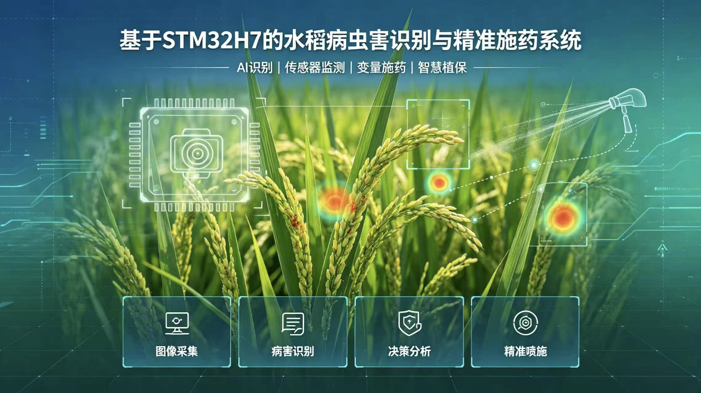
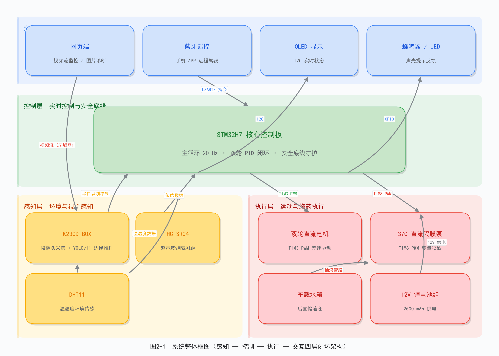
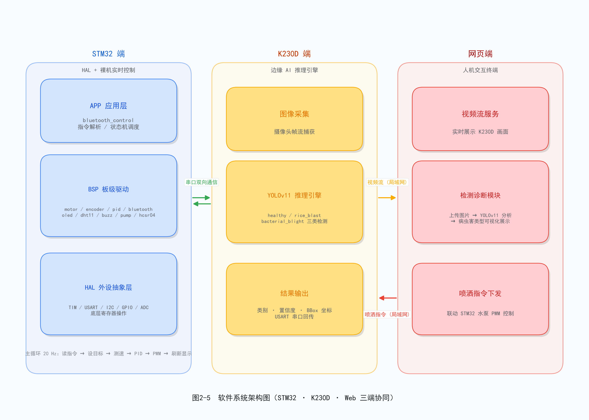
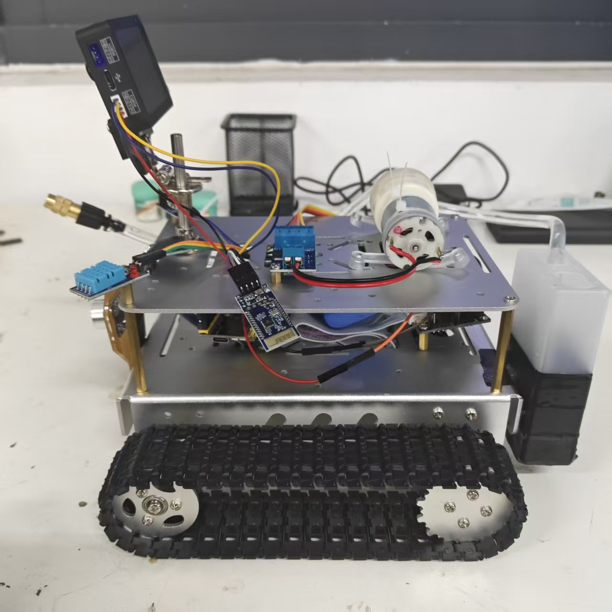
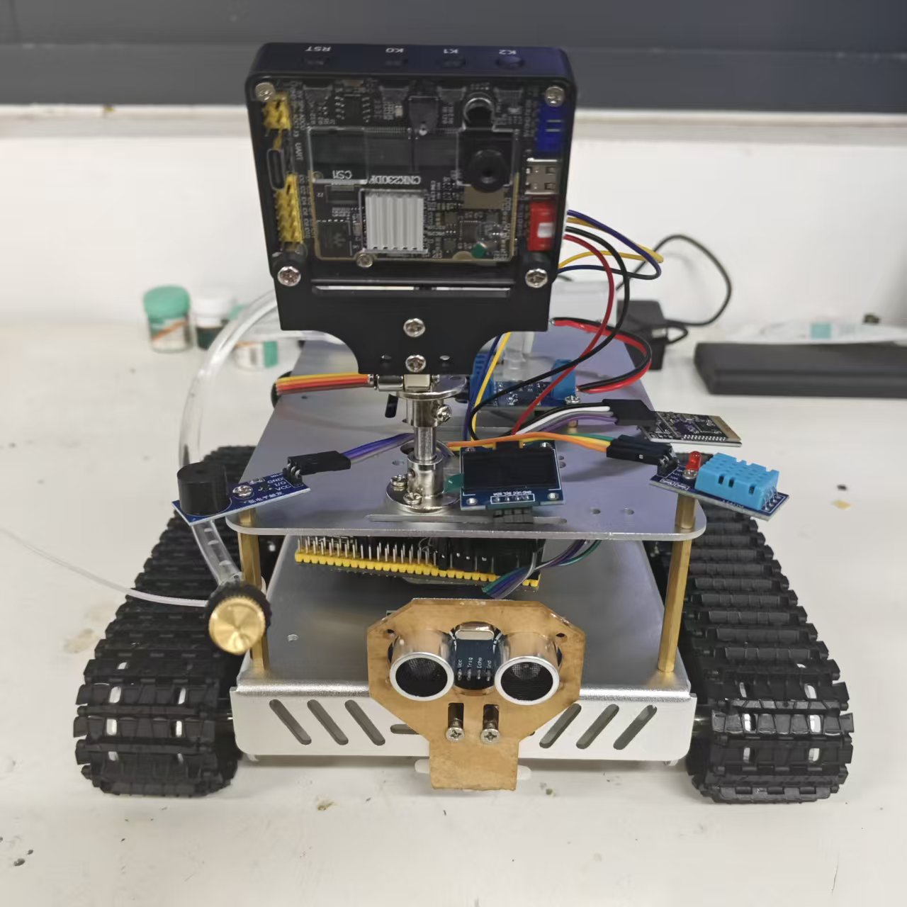
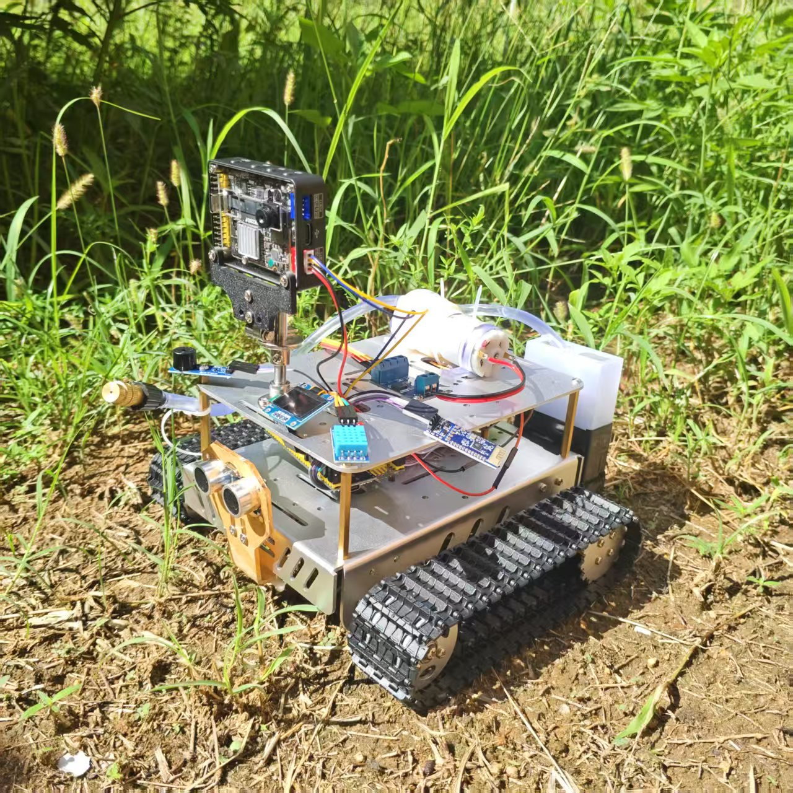
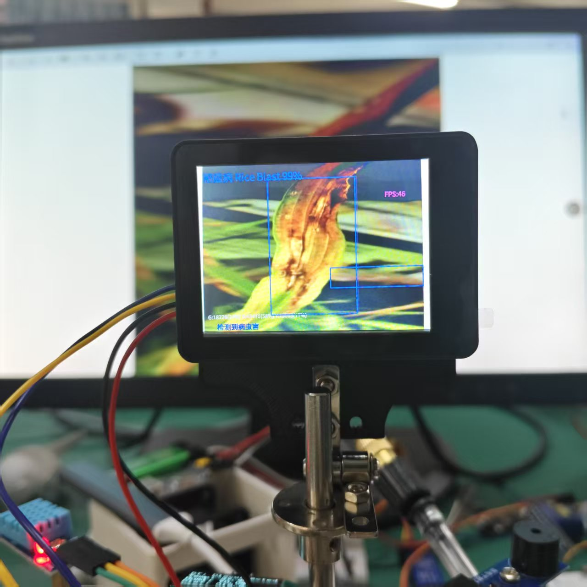
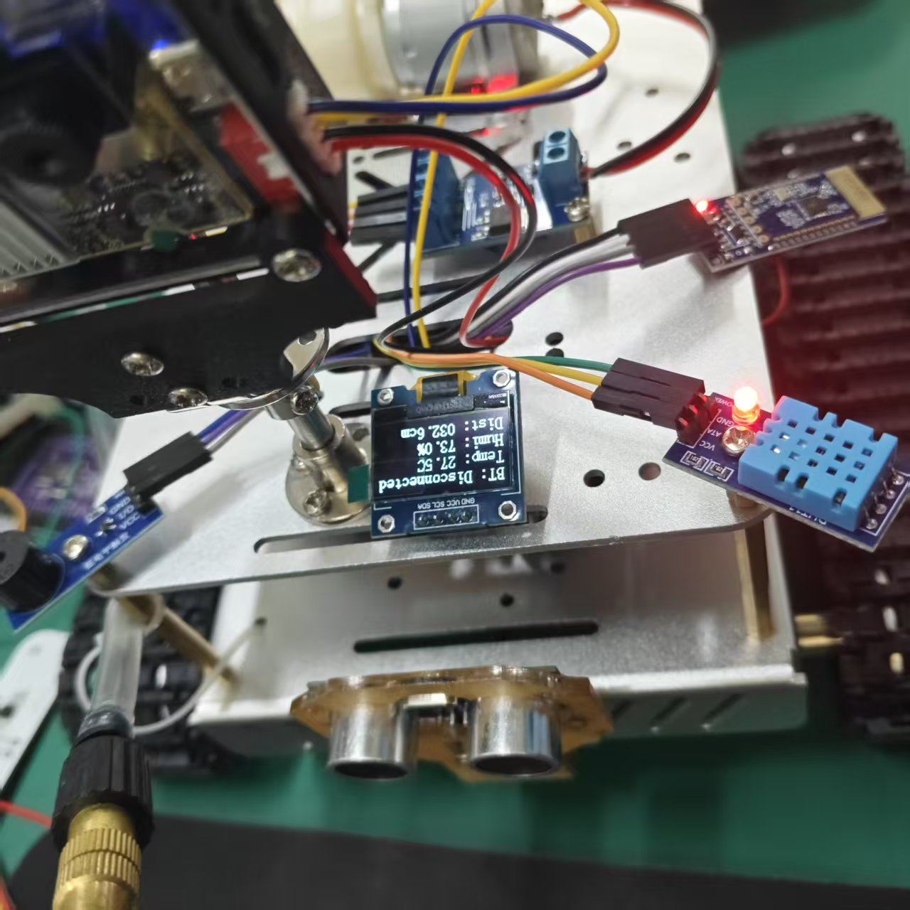
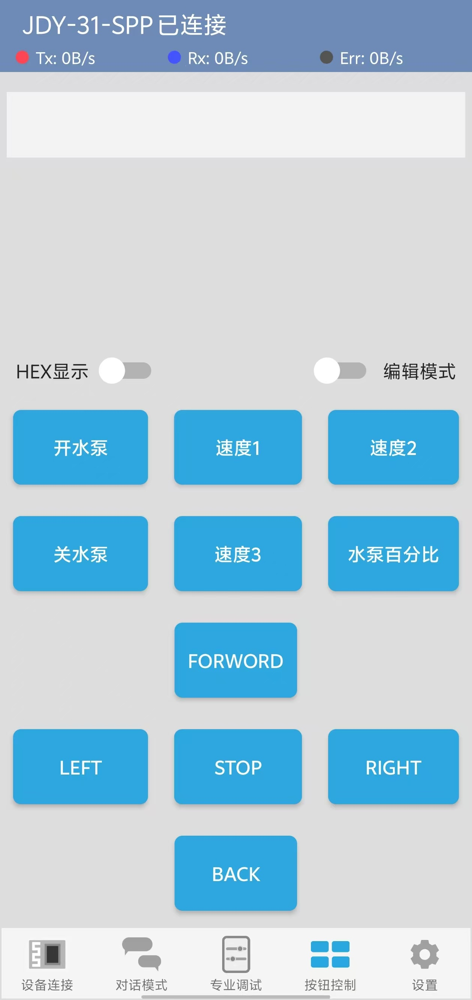

<div align="center">

# 基于 STM32H7 的水稻病虫害识别与精准施药系统

**边缘 AI 识别 · 双履带 PID 闭环 · 变量精准喷洒 · 人机协同作业**

[](LICENSE)




</div>

---

## 项目简介

水稻病虫害每年造成可观的产量与品质损失，田间植保长期依赖人工背负式喷雾，普遍存在**农药过量施用、药液飘移污染、人药接触风险**等痛点；而大型植保无人机又难以覆盖小农户、温室与设施农业的细碎场景。

本项目设计并实现了一种 **基于 STM32H7 的半自主式智能巡检与精准喷洒系统**，以微缩仿真稻田为验证场景：

- **移动小车** 远程驾驶巡检，STM32H7 底层死守运动安全底线；
- **K230D 边缘端** 实时识别病虫害类别（无云端依赖、低延迟）；
- 识别结果联动 **PWM 变量喷洒**，按需施药；
- **网页端 + 蓝牙遥控** 形成"人机协同"作业闭环。

系统无需依赖云端、响应低延迟、硬件低成本，为小地块与设施农业的精准植保提供了可复用的技术参考与实训载体。

## 系统架构

系统由**感知层、控制层、执行层、交互层**四部分构成，形成"感知 — 决策 — 执行"闭环：

<p align="center"></p>

- **感知层**：K230D BOX 视觉 + DHT11 温湿度 + HC-SR04 超声波测距
- **控制层**：STM32H743ZITx（Cortex-M7 @480MHz），主循环 20Hz，双轮 PID 闭环
- **执行层**：双履带直流电机（TIM3 PWM）+ 370 直流隔膜泵（TIM8 PWM）
- **交互层**：网页端视频监控/图片诊断 + 蓝牙遥控 + OLED 状态显示

### 软件架构

软件三端协同，模块化 BSP + APP 分层，各模块独立成文件、接口清晰：

<p align="center"></p>

| 层级 | 模块 | 说明 |
|------|------|------|
| APP 层 | `bluetooth_control` | 蓝牙指令解析（运动/水泵/状态机） |
| BSP 层 | `motor` / `encoder` / `pid` / `car` | 电机驱动、编码器四倍频、位置式 PID、整车控制 |
| BSP 层 | `bluetooth` / `OLED` / `DHT11` / `hcsr04` / `pump` / `buzz` / `debug` | 通信、显示、传感、执行器 |
| 视觉端 | `main_k230.py` | CanMV 实时识别脚本（LAB 颜色阈值 + 面积比例分类） |

## 功能特性

- **半自主巡检**：远程驾驶履带小车，前进/后退/转向 + 5 档速度切换（0.2 ~ 1.5 m/s）
- **履带 PID 闭环**：高级定时器 PWM + 正交编码器四倍频测速，位置式 PID 带抗饱和积分，左右履带独立闭环
- **边缘视觉识别**：K230 端本地实时识别健康 / 稻瘟病 / 白叶枯病，识别结果叠加显示、实时帧率约 46 FPS
- **变量精准喷洒**：PWM 驱动直流隔膜泵，0~100% 无级调节喷洒量
- **状态感知**：OLED 实时显示蓝牙状态、温湿度、超声波距离；蜂鸣器声光提示
- **人机协同**：蓝牙遥控 + 网页端监控，人负责决策兜底，机负责重复精准执行

## 核心技术指标

| 指标 | 参数 / 性能 |
|------|------------|
| 主控芯片 | STM32H743ZITx（Cortex-M7 @480MHz） |
| 视觉模块 | 正点原子 K230D BOX（双核 RISC-V） |
| 控制频率 | 20 Hz（50ms 周期） |
| 调速范围 | 0.2 ~ 1.5 m/s，5 档蓝牙遥控切换 |
| PID 参数与响应 | KP=200, KI=50；63% 响应 ≈ 1750ms，95% 响应 ≈ 2900ms |
| 识别实时性 | K230 端约 46 FPS，实测单帧置信度最高 99% |
| 喷洒流量 | 350 L/H（约 5.83 L/min），扬程 0 ~ 180 cm |
| 底盘尺寸 / 载重 | 190×230×102 mm / 约 2 kg（履带式） |
| 供电系统 | 12 V / 2500 mAh 锂电池组，车载后置独立供电 |
| 通信方式 | 蓝牙（USART3）+ 网页端 |

> 项目文档完整记录了 YOLOv11 模型训练过程与指标（训练 200 epochs，总体 mAP50=0.463，healthy 0.632，rice_blast 0.622），详见 [docs/](docs/) 目录。

## 目录结构

```text
.
├── README.md                            # 项目说明
├── LICENSE                              # MIT 开源许可证
├── docs/                                # 设计文档
│   └── 基于STM32H7的水稻病虫害识别与精准施药系统文档.pdf
├── images/                              # 图片素材
│   ├── banner.jpg                       # 项目横幅
│   ├── design/                          # 架构图 / 流程图
│   ├── car_photos/                      # 整车实物照片
│   └── field_photos/                    # 作业场景照片
├── firmware/                            # STM32H7 主控固件（Keil MDK 工程）
│   ├── APP/                             # 应用层（bluetooth_control）
│   ├── BSP/                             # 板级支持包（motor/encoder/pid/bluetooth/OLED/DHT11/hcsr04/pump/buzz/car/debug）
│   ├── Core/                            # CubeMX 生成的核心代码
│   ├── Drivers/                         # STM32H7 HAL 库 + CMSIS
│   ├── Motor_Test.ioc                   # STM32CubeMX 工程文件
│   └── MDK-ARM/Motor_Test.uvprojx       # Keil uVision 工程
└── vision/                              # K230 视觉端
    └── main_k230.py                     # CanMV 实时识别脚本
```

## 快速开始

### 1. 编译与烧录 STM32 固件

- 工具链：[Keil MDK-ARM](https://www.keil.com/mdk5)（ARMCC）+ [STM32CubeMX](https://www.st.com/en/development-tools/stm32cubemx.html)
- 步骤：
  1. 双击打开 `firmware/MDK-ARM/Motor_Test.uvprojx`；
  2. 点击 **Rebuild**（F7）编译工程；
  3. 连接 ST-Link / DAP-Link，点击 **Download**（F8）烧录至 STM32H743ZITx；
  4. 如需修改外设配置，可用 CubeMX 打开 `firmware/Motor_Test.ioc` 重新生成。
- 上电后 OLED 显示 `BT: Disconnected / Temp / Humi / Dist`，串口 1（115200）输出调试信息。

### 2. 部署 K230 视觉脚本

- 工具链：[CanMV IDE](https://developer.canaan-creative.com/)（嘉楠 K230）
- 步骤：
  1. 用 CanMV IDE 打开 `vision/main_k230.py`；
  2. 连接 K230D BOX 开发板，点击运行；
  3. 屏幕实时显示识别结果（类别 / 置信度 / G-B-Y 面积占比 / FPS）；
  4. 阈值参数集中在脚本头部 `THRESHOLDS` 字典中，可按现场光照条件微调 LAB 阈值。

### 3. 蓝牙遥控协议

通过 USART3 蓝牙模块（默认 115200）发送单字符指令：

| 指令 | 功能 | 指令 | 功能 |
|:----:|------|:----:|------|
| `F` | 前进 | `1` ~ `5` | 速度档位（0.2 / 0.4 / 0.7 / 1.0 / 1.3 m/s） |
| `B` | 后退 | `+` / `-` | 加速 / 减速（步进 0.2 m/s） |
| `L` | 左转 | `P` / `O` | 水泵开 / 关 |
| `R` | 右转 | `W0`~`W100` | 水泵 PWM 百分比（变量喷洒） |
| `S` | 停止 | | |

## 实物展示

<div align="center">

| | |
|:---:|:---:|
|  |  |
|  |  |

实时识别稻瘟病（置信度 99%，46 FPS）

| | |
|:---:|:---:|
|  |  |

OLED 状态显示与蓝牙遥控

</div>

更多照片见 [images/car_photos/](images/car_photos) 与 [images/field_photos/](images/field_photos)。

## 设计文档

完整的系统设计报告（需求分析、硬件选型、机械/电路设计、软件设计、性能测试与总结）：

- [基于STM32H7的水稻病虫害识别与精准施药系统文档.pdf](docs/基于STM32H7的水稻病虫害识别与精准施药系统文档.pdf)

其他设计图：

| 图 | 说明 |
|----|------|
| [fig1-3_design_flow.png](images/design/fig1-3_design_flow.png) | 系统设计流程图 |
| [fig2-7_workflow.png](images/design/fig2-7_workflow.png) | 关键模块流程图 |
| [fig_pid_loop.png](images/design/fig_pid_loop.png) | PID 控制环路 |
| [fig_bt_state.png](images/design/fig_bt_state.png) | 蓝牙状态机 |

## 已知局限与未来计划

- [ ] 自主导航：增加 IMU / 视觉 SLAM 与路径规划，由遥控升级为自主巡检
- [ ] 智能避障：超声波 + 视觉融合避障
- [ ] 多机协同：多车编队分区作业
- [ ] 电量管理：ADC 监测电池电压，低电量回充/报警
- [ ] 模型扩展：扩充病虫害种类与数据集，提升小目标识别能力（bacterial_blight 类小样本待扩充）

## 许可证

本项目基于 [MIT License](LICENSE) 开源发布。

固件中的 STM32 HAL 库、CMSIS 组件版权归 STMicroelectronics / ARM 所有，遵循其原始许可协议（见各目录内 LICENSE 文件）。

---

<div align="center">

如果这个项目对你有帮助，欢迎点一个 **Star** ⭐

</div>
